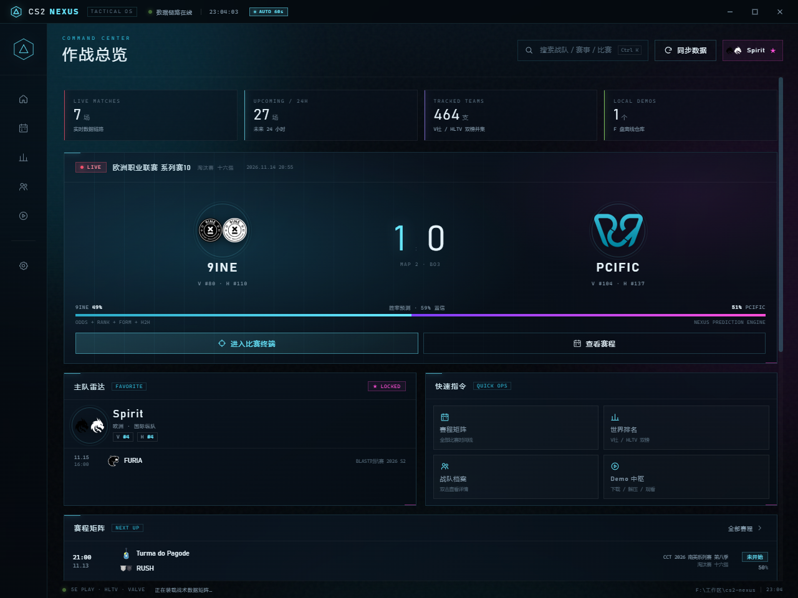
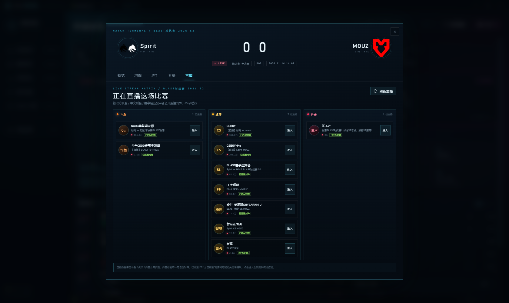
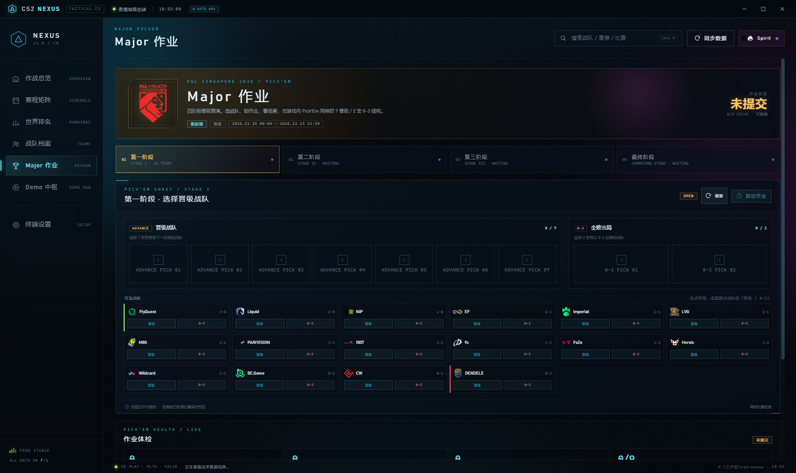
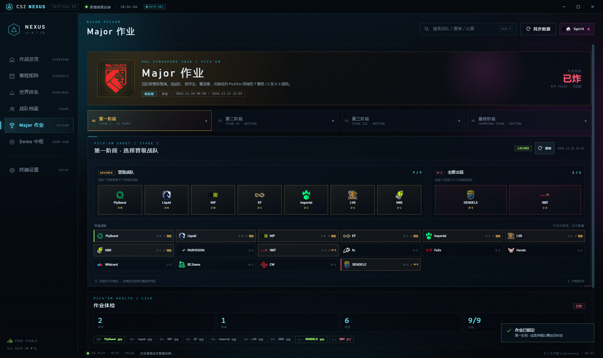
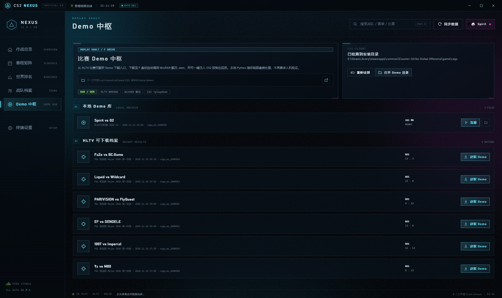

# CS2 NEXUS

> 面向 CS2 赛事观众的本地观赛终端。  
> 5E / HLTV 双榜 · 实时赛程 · 战队与选手档案 · 直播矩阵 · Major 作业 · Demo 中枢



CS2 NEXUS 是一个 Electron 桌面应用，把每天要开的几个 CS2 页面收进一个科幻风终端里：看比赛、查战队、翻选手数据、找正在播的主播、做 Major 作业、下载 Demo，都在同一个窗口完成。

项目使用原生 HTML / CSS / JavaScript，没有前端框架依赖；所有排名、赛程、Demo、缓存和作业选择都保存在本地 `data` 目录，不上传云端。

---

## 功能

### 01 · 作战总览

- 当前 LIVE 比赛、24 小时内 UPCOMING、已跟踪战队数量、本地 Demo 数量。
- 主队锁定：设置主队后，首页优先显示主队下一场、主队赛程和胜率推演。
- 胜率预测：赛前赔率、双榜排名、近期状态、交手记录四项加权；没有赔率时自动回退到排名 / 状态 / 交手。
- 窗口重新获得焦点、系统从睡眠唤醒时立即补一次同步；超过 3 小时仍未更新的“直播”会自动归为已结束，避免首页长期挂着旧比赛。

### 02 · 赛程矩阵

- 5E 赛程、比分、BO 赛制、赛事阶段、赛前赔率。
- 按状态（LIVE / UPCOMING / FINISHED）、赛事、关键词筛选。
- 双击任意比赛进入比赛终端：概览、地图、选手、分析、直播。

### 03 · 世界排名

- Valve 区域积分榜（内置快照 395 支）。
- HLTV 官方世界排名（内置快照 252 支）。
- 同时保留 5E 镜像的 HLTV 榜单（336 条）用于交叉核对。
- 双击排名行打开战队档案。

### 04 · 战队与选手档案

- 战队：胜率、地图数、KD、教练、奖金、五人阵容、近期赛程、荣誉。
- 选手：点击阵容卡或比赛选手行，查看 Rating / ADR / KAST / KD、地图池、荣誉、最近比赛。
- 平台入口：5E、Steam、FACEIT、完美世界、HLTV。
- 选手档案内可切换“比赛记录 / 地图 / 荣誉”三个页签。

### 05 · 直播主播矩阵

进行中的比赛打开比赛终端后，会出现 **直播** 标签：

- 并行查询斗鱼、虎牙、抖音三个平台。
- 按双方队名、中文别名和赛事名匹配直播标题。
- 虎牙标题没有写队名时，会进一步读取房间页的赛事标签确认双方；例如 DANK1NG 会显示“赛事页确认”。
- 抖音标题经常只有主播名，未精确匹配时会明确标注“CS2 分区在播”，不冒充已匹配对阵。
- 45 秒缓存，可手动刷新；头像加载失败时按平台色显示昵称首字。



### 06 · Major 作业

赛事开始前 7 天开放，按游戏内 Pick'Em 的形式做四阶段作业：

- **第一阶段 / 第二阶段 / 第三阶段**：各选 **7 支晋级** + **2 支 0-3**。
- **最终阶段**：选 **2 支进入决赛**的战队。
- 点空框或直接点战队按钮入位；选满后点“锁定作业”，锁定后只读。
- 根据已结束比赛实时判定：**命中 / 炸掉 / 待定**，顶部显示 **存活 / 已炸 / 完美 / 未提交**。
- 底部按当前瑞士轮战绩分组：`1-0`、`0-1`、`2-0`、`0-2`、`1-1`、`1-2`、`2-1`、`3-0`、`3-1`、`3-2`、`2-2`、`2-3`、`1-3`、`0-3`。
- 后续阶段在上一阶段结束前显示“等待战队确认”，不会用 TBD 或猜测战队填充。
- 选择和锁定状态保存在 `data/app/major-picks.json`。

当前版本接入 **PGL 新加坡 Major 2026**，开赛前一周（2026-11-17）解锁。赛程来自 5E 全量比赛接口，因此能补齐实时列表里已经翻过去的第一轮历史战绩。





### 07 · Demo 中枢

- 从 HLTV 比赛页解析 Demo 下载入口，再解析 R2 直链。
- 使用本地 Python + `curl_cffi` 指纹链路，**不需要在应用里过人机验证**。
- 4 路并行分段下载，支持进度条、失败重试和断点临时文件清理。
- 下载完成后调用 WinRAR / UnRAR 解压 `.dem`，写入本地 Demo 索引。
- 一键复制 `.dem` 到 CS2 目录并启动 `+playdemo`。

> 仓库不包含任何 `.dem` 或 `.rar` 文件。Demo 由用户在使用时从 HLTV 下载，请遵守 HLTV / 赛事方的使用条款，不要重新分发。

---

## 预览

| 首页 | 世界排名 |
| --- | --- |
|  |  |

| 直播矩阵 | Demo 中枢 |
| --- | --- |
|  |  |

---

## 技术栈

- **Electron 38**：主进程 + preload + 渲染进程，`contextIsolation: true`。
- **原生 HTML / CSS / JavaScript**：单页应用，无 React / Vue / 构建步骤。
- **5EPlay 数据节点**：实时赛程、比赛详情、战队、选手、地图、赔率、Valve 排名。
- **HLTV**：官方世界排名、比赛页、Demo 链接；通过本地 Python 解析 Cloudflare 保护页面。
- **Python 3.13 + curl_cffi + BeautifulSoup + lxml**：HLTV 页面与 R2 下载链路。
- **Window / PowerShell**：便携版打包、CS2 安装路径检测、Demo 解压与启动。

### 数据流

```text
5E 实时接口 ─┐
5E 全量赛程 ─┼─> main.js 归一化 ─> 内存状态 ─> IPC snapshot ─> app.js 渲染
HLTV 排名 ───┘                         │
                                       ├─ data/cache/  运行期缓存
                                       └─ data/app/    设置、作业选择、本地状态

HLTV 比赛页 ─> scripts/hltv-demo.py ─> R2 分段下载 ─> UnRAR ─> data/demos/*.dem
```

- 每 **60 秒**拉取 5E 实时赛程 / 赛果。
- 每 **15 分钟**刷新双榜与战队索引。
- 所有数据路径默认落在项目目录的 `data` 下，不写 C 盘用户目录。

---

## 快速开始

### 环境

- Windows 10 / 11
- Node.js 20+（开发时使用 24.17.0）
- npm 10+
- Python 3.13（仅 Demo 下载需要；依赖已放在 `vendor/py`，也可用 `requirements.txt` 自行安装）
- WinRAR 或 UnRAR（Demo 解压）
- 已安装 CS2（Demo 播放需要；不安装也能查看赛程和其他功能）

### 安装与运行

```powershell
git clone https://github.com/olaizd/cs2-nexus.git
cd cs2-nexus

npm install

# 这台机器上如果设置过 ELECTRON_RUN_AS_NODE，Electron 会被当成 Node 执行
Remove-Item Env:ELECTRON_RUN_AS_NODE -ErrorAction SilentlyContinue
$env:TEMP = "$PWD\.tmp"
$env:TMP  = "$PWD\.tmp"

npm start
```

如果 Demo 下载提示缺少 Python 包：

```powershell
python -m pip install -r requirements.txt
```

应用默认优先使用 `vendor/py` 中的依赖，因此大多数情况下不需要额外安装。

### 打包便携版

```powershell
node scripts/bundle.cjs
```

输出：

```text
release/CS2 NEXUS/
├─ CS2 NEXUS.exe
├─ resources/app/          # 应用代码
├─ data/                   # 种子数据与 Demo
└─ 启动说明.txt
```

便携版约 600 MB（含 Electron 运行时和 Demo 示例时更大）。`release/` 是构建产物，不提交到仓库。

---

## 目录结构

```text
cs2-nexus/
├─ main.js                 # 主进程：5E/HLTV 数据、同步、Demo、窗口、IPC
├─ preload.js              # contextBridge，暴露 window.nexus
├─ package.json
├─ app/
│  ├─ index.html           # 壳、标题栏、侧栏、视图容器
│  ├─ app.js               # SPA 状态、页面渲染、事件、Major 作业逻辑
│  └─ styles.css           # 科幻风主题、Major Pick'Em、档案、直播样式
├─ assets/                 # 应用图标
├─ data/
│  ├─ seed/                # 排名、战队、赛程种子快照
│  └─ demos/index.json     # 本地 Demo 索引（Demo 文件不入库）
├─ scripts/
│  ├─ bundle.cjs           # 便携版打包
│  ├─ collect-data.cjs     # 数据采集
│  ├─ collect-rankings.cjs
│  ├─ hltv-demo.py         # HLTV / R2 Demo 解析与并行下载
│  ├─ parse-hltv-rank.py
│  └─ ...
├─ vendor/py/              # 内置 Python 依赖（curl_cffi 等）
└─ docs/screenshots/       # README 截图
```

---

## 数据来源与边界

| 数据 | 来源 |
| --- | --- |
| 赛程 / 比分 / 战队 / 选手 / 地图 / 赔率 | 5EPlay 赛事数据节点 |
| Valve 区域积分榜 | 5E `valve_rank` 镜像 |
| HLTV 世界排名 | HLTV 官方榜单 |
| 直播主播 | 斗鱼、虎牙、抖音公开直播页 |
| Demo | HLTV 比赛页 → R2 下载直链 |
| Major 作业 | 5E 全量比赛接口 + 本地选择 |

已知边界：

- **平台接口不是官方稳定 API**，改版、限流或反爬可能导致偶发失败；赛程、排名、战队等已有本地快照兜底。
- **直播匹配不是官方映射**。平台没有公开“赛事-房间”关系，只能按标题、队名、中文别名和房间页标签匹配；抖音尤其容易出现标题不含对阵的情况，此时会明确标注“分区在播”。
- **HLTV Demo 需要本地 Python 3.13 + curl_cffi + WinRAR**；纯前端或没有 Python 的环境无法下载 Demo。仓库不附带 Demo 文件。
- **Major 作业后续阶段**在上一阶段结束前是 TBD；页面会显示等待，不做猜测。
- **完美世界 PVP 公开站**主要提供天梯 / 赛季数据，没有职业战队赛事 API；职业赛事数据以 5E + HLTV 为主。
- 本项目只在 Windows 上开发和验证；Linux / macOS 未测试。
- 数据与 Demo 的版权归原平台 / 赛事方所有。本项目仅用于个人学习和观赛辅助，不提供任何赛事直播流或 Demo 的重新分发。

---

## 免责声明

CS2 NEXUS 是个人项目，与 Valve、5EPlay、HLTV、斗鱼、虎牙、抖音均无关联。

使用本项目时请遵守各平台的服务条款和 robots 规则，不要高频请求、批量抓取或重新分发受版权保护的数据与 Demo。因使用本项目产生的任何后果由使用者自行承担。

## License

[MIT](LICENSE)
